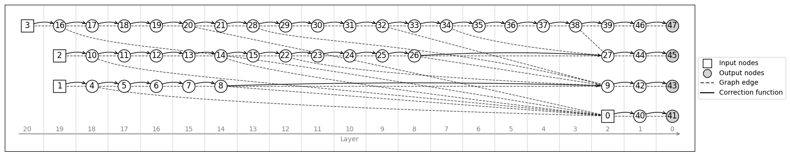
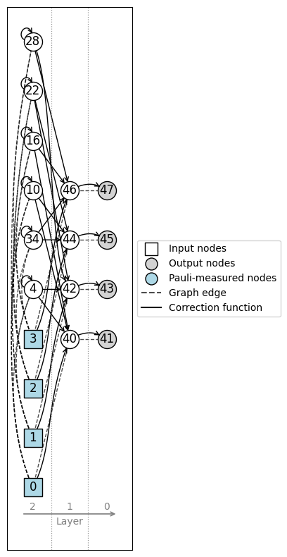

<p align="center">
  <picture>
    <source
      media="(prefers-color-scheme: dark)"
      srcset="assets/white_with_name.png"
    >
    <source
      media="(prefers-color-scheme: light)"
      srcset="assets/black_with_name.png"
    >
    
  </picture>
</p>


[](https://pepy.tech/project/graphix)
[](https://unitary.foundation/)
[](https://zenodo.org/badge/latestdoi/573466585)
[](https://github.com/TeamGraphix/graphix/actions/workflows/ci.yml)
[](https://codecov.io/gh/TeamGraphix/graphix)
[](https://graphix.readthedocs.io/en/latest/?badge=latest)
[](https://github.com/astral-sh/ruff)

**Graphix** is a measurement-based quantum computing (MBQC) software package, featuring

- The measurement calculus framework with integrated graphical rewrite rules for pre-processing Pauli measurements
- Circuit-to-pattern transpiler, graph-based deterministic pattern generator and manual pattern generation
- Causal flow, Gflow and Pauli flow finding tools and graph visualization based on flows (see below)
- Statevector, density matrix and tensor network pattern simulation backends
- Export to OpenQASM for external simulation and QPU integration
- [Efficient implementation of fast $\mathcal{O}(N^3$) Pauli flow-finding algorithm](https://github.com/TeamGraphix/graphix/pull/337)

## Installation

Install `graphix` with `pip`:

```bash
pip install graphix
```

### Editable installation using pip and uv

As well as support for editable installation using pip, Graphix also supports using `uv`:

```bash
git clone https://github.com/TeamGraphix/graphix.git
cd graphix
uv sync --extra dev
```

This creates a virtual environment and installs all development dependencies from the `pyproject.toml` and `uv` lockfile.

## Using graphix

### Generating a pattern from a circuit

```python
from graphix import Circuit

circuit = Circuit(4)
...
pattern = circuit.transpile().pattern
pattern.standardize()
pattern.shift_signals()

pattern.draw_graph(flow_from_pattern=False)
```



<small>See [our example code](examples/qaoa.py) to generate this pattern. Arrows indicate the [_causal flow_](https://journals.aps.org/pra/abstract/10.1103/PhysRevA.74.052310) of MBQC and dashed lines are the other edges of the graph. The vertical dashed partitions and the labels below indicate the execution _layers_ based on the partial order associated with the (maximally-delayed) flow of the graph. Measurements should happen from left to right, and nodes in the same layer can be measured simultaneously. </small>

### Pre-processing Pauli measurements (Clifford gates)

```python
pattern.infer_pauli_measurements()
pattern.remove_pauli_measurements()

pattern.draw(flow_from_pattern=False)
```


<small>(here, the visualization is based on [_generalized flow_](https://iopscience.iop.org/article/10.1088/1367-2630/9/8/250)).</small>

### Simulating the pattern

```python
state_out = pattern.simulate(backend="statevector")
```

### And more..

- See [demos](https://graphix.readthedocs.io/en/latest/gallery/index.html) showing other features of `graphix`.
- Read the [tutorial](https://graphix.readthedocs.io/en/latest/tutorial.html) for more usage guides.
- For theoretical background, read our quick introduction into [MBQC](https://graphix.readthedocs.io/en/latest/intro.html) and [LC-MBQC](https://graphix.readthedocs.io/en/latest/lc-mbqc.html).
- Full API docs is [here](https://graphix.readthedocs.io/en/latest/references.html).

## Graphix plugins

- [`graphix-ibmq`](https://github.com/TeamGraphix/graphix-ibmq): pattern transpiler for IBMQ / `qiskit`
- [`graphix-perceval`](https://github.com/TeamGraphix/graphix-perceval): pattern transpiler for Quandela's `perceval` simulator and QPU
- [`graphix-pyzx`](https://github.com/TeamGraphix/graphix-pyzx): conversion between open graphs and PyZX diagrams
- [`graphix-qasm-parser`](https://github.com/TeamGraphix/graphix-qasm-parser): a plugin for parsing OpenQASM circuit.
- [`graphix-stim-backend`](https://github.com/TeamGraphix/graphix-stim-backend): `stim` backend for efficient Clifford pattern simulation
- [`graphix-stim-compiler`](https://github.com/TeamGraphix/graphix-stim-compiler): `stim` backend for efficient compilation of Clifford maps.
- [`graphix-symbolic`](https://github.com/TeamGraphix/graphix-symbolic): parameterized patterns with symbolic simulation
- [`graphix-mqtbench`](https://github.com/TeamGraphix/graphix-mqtbench): an interface between Graphix and the [MQT Bench](https://mqt.readthedocs.io/projects/bench/en/latest/index.html) suite for benchmarking purposes.
## Related packages

- [swiflow](https://github.com/TeamGraphix/swiflow): rust-based implementation of flow-finding algorithms.
- [graphqomb](https://github.com/TeamGraphix/graphqomb): modular graph state compiler for fault-tolerant MBQC and more.

### Projects using `graphix`

- [veriphix](https://github.com/qat-inria/veriphix): verified blind quantum computation and benchmarking.
- [optyx](https://github.com/quantinuum-dev/optyx): ZX-based software for networked quantum computing.

## Citing

If you use Graphix, please cite us as:
```
@software{graphix_v04,
  author    = {Uldemolins, Mateo and Fukushima, Masato and
              Graham, Emlyn and Nair, Pranav and Sasaki, Daichi and
              Shiratani, Sora and Watanabe, Yuki and
              Martinez, Thierry and Garnier, Maxime and Sunami, Shinichi},
  title     = {Graphix},
  version   = {0.4},
  year      = {2026},
  publisher = {Zenodo},
  doi       = {10.5281/zenodo.21997813},
}

@article{uldemolins2026_graphix,
  title={Graphix: A software framework for Measurement-Based Quantum Computation},
  author={Uldemolins, Mateo and Nair, Pranav and Graham, Emlyn and Sunami, Shinichi and Martinez, Thierry and Garnier, Maxime},
  journal={arXiv preprint arXiv:2608.24781},
  year={2026}
}
```

## Contributing

We use [GitHub issues](https://github.com/TeamGraphix/graphix/issues) for tracking feature requests and bug reports.

## Discussion channels

- Our Slack channel, for regular discussions and questions: https://graphix-org.slack.com

- Please visit [Unitary Foundation's Discord server](https://discord.com/servers/unitary-foundation-764231928676089909), where you can find a channel for `graphix`.

## Current maintainers (alphabetical order)

- Maxime Garnier (Inria Paris)
- Thierry Martinez (Inria Paris)
- Pranav Nair (Inria Paris)
- Mateo Uldemolins (Inria Paris)

## Acknowledgements

Graphix was founded in 2022 by Shinichi Sunami (University of Oxford) with assistance from Masato Fukushima (University of Tokyo, Fixstars Amplify), supported by [Fixstars Amplify](https://amplify.fixstars.com/en/) and [Unitary Foundation](https://unitary.foundation/grants.html), and later joined by Daichi Sasaki, Yuki Watanabe and Sora Shiratani (University of Tokyo, Fixstars Amplify). 

<p align="center">
<a href="https://unitary.foundation/grants/" style="margin-right: 30px;">

</a>
<a href="https://amplify.fixstars.com/en/" style="margin-right: 30px;">

</a>
</p>

Since 2023, Graphix team is joined by the Qode group of the [QAT](https://qat.inria.fr/presentation/) team, co-hosted by [Inria](https://www.inria.fr/) and [ENS](https://www.ens.psl.eu/), which now develops and maintains the library. We thank Emlyn Graham (Inria Paris) for his contributions to Graphix from 2025 to 2026.

<p align="center">
<a href="https://www.inria.fr/" style="margin-right: 30px;">
  
</a>
&nbsp;
<a href="https://www.ens.psl.eu/" style="margin-right: 30px;">
  
</a>
&nbsp;
<a href="https://qat.inria.fr/presentation/" style="margin-right: 30px;">
  
</a>
</p>

Special thanks also to [HQI](https://www.hqi.fr).
<p align="center">
<a href="https://www.hqi.fr">
  
</a>
</p>


## License

[Apache License 2.0](LICENSE)
